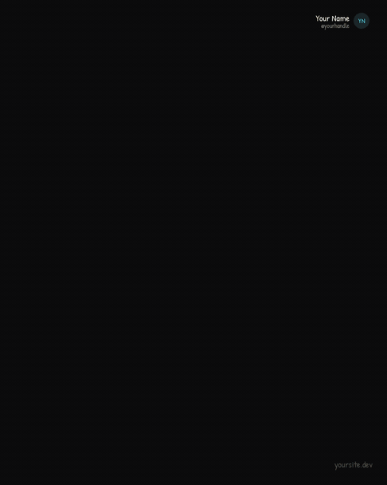
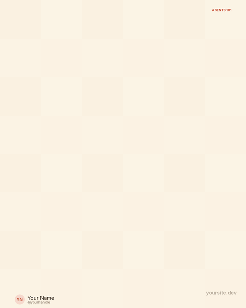
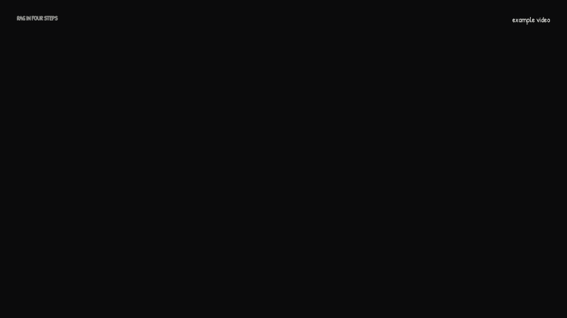

# explainer-video-skill

Animated explainer videos, GIFs, arrow-flow images and PDF carousels from a JSON scene spec. Works as a Claude skill and as a standalone CLI.

<p align="center">
  
  &nbsp;
  
</p>
<p align="center">
  
</p>

<p align="center"><sub>Rendered by this repo from <code>examples/</code>: dark sketch (LinkedIn 4:5), warm arrow-flow loop, and a captioned landscape video. Same specs, different <code>--canvas</code>, <code>--style</code> and <code>--theme</code>.</sub></p>

Describe a topic, get animated diagrams (boxes, arrows, loops, token grids, step tabs) as a narrated video, a captioned video, or a silent one that carries its message in on-screen text. Just Python, Pillow, numpy and ffmpeg: no browser, no GPU.

```
spec.json -> (optional) narration/*.txt -> your TTS -> audio/*.mp3 -> video.mp4 / .gif / .png / .pdf (+ .srt)
```

## What it can make

| Choice | Options |
|---|---|
| Shape (`canvas`) | `landscape` 16:9, `square`, `portrait` / `linkedin` 4:5, `story` 9:16 (Reels, Shorts), or `[w, h]` |
| Style | `clean` (flat, polished) or `sketch` (hand-drawn whiteboard, strokes drawn live) |
| Theme | `light`, `warm` (cream and terracotta), `dark`, or your own colours |
| Output | `.mp4`, `.gif` (loop), `.png` (single arrow-flow image), `.pdf` (carousel, one page per scene) |
| Audio | `none` (text on screen), `files` (your clips), `generate` (Kokoro via narrate-your-writing, edge-tts, Piper, or any command) |
| Captions | burned in (default when silent) and an `.srt` file for narrated videos |
| Branding | author name, handle and round avatar (placeholder initials until you add an image), watermark text or logo |

One spec can export every shape: `--canvas linkedin,story,landscape`. Sequences use an auto-laid-out `flow` element, so the same spec fits wide and tall canvases.

## Quick start

```bash
pip install pillow numpy          # plus ffmpeg on your PATH
python scripts/evideo.py validate examples/mcp-explained-sketch.json
python scripts/evideo.py render examples/mcp-explained-sketch.json --out out/mcp.mp4 --fast
python scripts/evideo.py render examples/agent-loop-flow.json --out out/loop.gif
python scripts/evideo.py render examples/agent-loop-flow.json --out out/flow.png
python scripts/evideo.py render examples/mcp-explained-sketch.json --canvas linkedin --out out/carousel.pdf
```

Override the look without editing the spec: `--canvas`, `--style`, `--theme`.

With a voice:

```bash
python scripts/evideo.py render examples/rag-pipeline.json --audio generate \
    --tts narrate-your-writing --narrate-path ../narrate-your-writing/narrate.py --out out/rag.mp4
```

Or do it by steps: `narration` writes the text files, `audio` makes the clips, `render --audio files` assembles. See [`recipes/tts.md`](recipes/tts.md).

Personalise: set `video.author` (name, handle, `avatar` image path) and `video.watermark` in the spec.

## Use it as a Claude skill

Copy this folder into your skills directory under the name `explainer-video` (for Claude Code: `.claude/skills/explainer-video/`) or zip it and add it in Claude settings. Then ask, for example: "make a 45 second dark sketch explainer about how MCP works for LinkedIn, no audio". `SKILL.md` tells Claude to pick the output, storyboard, write and validate the spec, look at stills, and render.

## Layout

| Path | Contents |
|---|---|
| `scripts/evideo.py` | renderer and CLI |
| `references/spec.md` | every spec field |
| `docs/` | the demo GIFs shown above |
| `examples/` | three working specs (sketch story, flow GIF, narrated landscape) |
| `recipes/tts.md` | voice engines |
| `tests/smoke.py` | validates every example across canvases, styles and themes; renders stills, GIF, PNG, PDF |
| `assets/fonts/` | Inter, Patrick Hand, Caveat (SIL OFL licences included) |

## Why not Remotion or Manim?

They are excellent and this project learns from them. The trade-off here is deliberate: a declarative spec and a tiny dependency set that runs the same on a laptop CPU, in CI and in a sandbox, and that an LLM can write reliably. If you need 3D, equations or arbitrary React components, use those tools.

The hand-drawn dark look is inspired by the common whiteboard explainer genre; no one's content or branding is bundled.

## Contributing

New element types, themes, canvas presets, TTS recipes and example specs are welcome. See [CONTRIBUTING.md](CONTRIBUTING.md).

## Licence

MIT. Bundled fonts are under the SIL Open Font Licence (see `assets/fonts/`). Voice models have their own licences; do not clone a voice without the speaker's consent.
